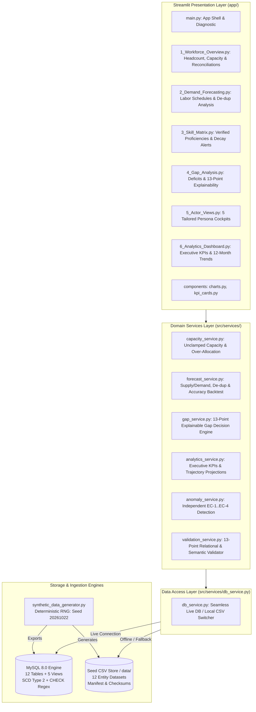

# Workforce Intelligence Platform

[](https://www.python.org/downloads/release/python-3110/)
[](https://streamlit.io/)
[](https://www.mysql.com/)
[](https://www.sqlalchemy.org/)
[](tests/)
[](LICENSE)

An enterprise-grade, data-driven workforce planning, capacity management, and capability gap analysis platform built with **Python 3.11**, **MySQL 8.0**, **SQLAlchemy 2.0**, **Pandas**, and **Streamlit**.

---

## Table of Contents

1. [Project Overview](#1-project-overview)
2. [Problem Statement](#2-problem-statement)
3. [Proposed Solution](#3-proposed-solution)
4. [Key Features](#4-key-features)
5. [System Architecture](#5-system-architecture)
6. [Technology Stack](#6-technology-stack)
7. [Project Directory Structure](#7-project-directory-structure)
8. [Application Modules and Responsibilities](#8-application-modules-and-responsibilities)
9. [Database Design](#9-database-design)
10. [Machine Learning & Demand Forecasting Methodology](#10-machine-learning--demand-forecasting-methodology)
11. [Data Processing, Validation & EDA](#11-data-processing-validation--eda)
12. [Installation and Setup Instructions](#12-installation-and-setup-instructions)
13. [Environment Variables and Configuration](#13-environment-variables-and-configuration)
14. [Database Setup Instructions](#14-database-setup-instructions)
15. [How to Run the Application](#15-how-to-run-the-application)
16. [How to Run Tests](#16-how-to-run-tests)
17. [Screenshots & Application Demo](#17-screenshots--application-demo)
18. [Results and Evaluation Metrics](#18-results-and-evaluation-metrics)
19. [Limitations and Future Enhancements](#19-limitations-and-future-enhancements)
20. [Submission Documentation](#20-submission-documentation)
21. [Team & Author Information](#21-team--author-information)

---

## 1. Project Overview

The **Workforce Intelligence Platform** delivers an automated, mathematically rigorous, and auditable decision-support system designed to balance enterprise talent supply against project labor demand.

The platform bridges organizational silos by harmonizing employee availability, approved leave calendars, multi-tier competency ratings, and forward-looking project delivery schedules into unified operational cockpits. With support for both live **MySQL 8.0** connection pools and zero-configuration **CSV fallback mode**, it enables immediate execution in local evaluation environments and seamless scaling to enterprise workloads (5,000+ employees and 500+ projects).

---

## 2. Problem Statement

Enterprise workforce management routinely encounters severe operational friction:

- **Hidden Capacity Over-Allocations**: Standard HR and resource tools clamp negative capacity to zero or report aggregated monthly averages, masking acute weekly scheduling conflicts where key personnel are committed to 120%–150% load across multiple client projects.
- **Uncoordinated Leave Impacts**: Approved paid time off (PTO), parental leave, and sick days exist in HR silos without automatically deducting from project bench capacity, causing sudden delivery crunches.
- **Duplicate Demand Inflation**: Decentralized project managers submit duplicate staffing requisitions for identical roles, skills, and timeframes, artificially inflating recruiting budgets and distorted demand forecasts.
- **Skill Currency & Stale Assessments**: Competency inventories often fail to track recency; active staff possess certified skills evaluated over 18 months prior that no longer reflect production competency.
- **Black-Box Staffing Decisions**: Recommendations to hire externally or reassign staff lack mathematical explainability, unit costs, lead times, or auditable decision trails.

---

## 3. Proposed Solution

The Workforce Intelligence Platform solves these challenges through an integrated data architecture and decision engine:

1. **Source-Driven Weekly Capacity Engine**: Calculates true employee-level capacity using un-clamped arithmetic:
   $$\text{Contracted Hours} = \text{Base Capacity} \times \text{FTE}$$
   $$\text{Net Available Capacity} = \text{Contracted Hours} - \text{Approved Leave}$$
   $$\text{Remaining Bench Capacity} = \text{Net Capacity} - \text{Allocated Project Hours}$$
   Negative capacity balances are preserved to explicitly compute over-allocation percentages.
2. **Period-Specific Demand Forecasting**: Matches project demand against active, qualified supply across all 53 ISO weeks of 2026 (`YYYY'W'WW`) while strictly excluding expired skills and ratings older than 18 months.
3. **Demand De-duplication Quarantine**: Automatically detects composite duplicate demands (`project_id + role_id + skill_id + start_date + end_date`) and presents side-by-side raw vs. corrected forecasts to eliminate double-counted FTE.
4. **13-Point Explainable Recommendation Engine**: Produces auditable recommendations (`HIRE_EXTERNAL`, `REASSIGN_BENCH`, `UPSKILL_INTERNAL`, `ENGAGE_CONTRACTOR`, `CROSS_TRAIN`) containing full context on demand, supply, bench availability, proficiency gaps, and lead times under a `PROPOSED` review lifecycle.
5. **Independent Anomaly Detection Benchmark**: Hardened model-based algorithms detect four labeled operational edge cases (EC-1 through EC-4) directly from transactional data without leaking ground truth labels.
6. **Immutable Historical Audit Logging**: Captures entity mutations with JSON state diffs (`old_state`, `new_state`) across seven organizational lifecycle events.

---

## 4. Key Features

- **Multi-Persona Cockpits**: Dedicated dashboard interfaces for Employees, Resource Managers, HR Business Partners, IT/Operations, and System Administrators.
- **Comprehensive 13-Point Data Validator**: Standalone verification service auditing primary keys, foreign keys, null constraints, enums, date ordering, SCD Type 2 intervals, and arithmetic consistency.
- **Statistical Forecast Accuracy Evaluation**: Built-in empirical holdout backtesting engine computing Mean Absolute Error (MAE), Root Mean Squared Error (RMSE), Weighted Absolute Percentage Error (WAPE%), and Forecast Bias%.
- **Deterministic Synthetics & Cryptographic Provenance**: 100% reproducible data generation (`seed: 20261022`) with SHA-256 manifest verification across both starter and enterprise scales.
- **Dual Persistence Architecture**: High-performance MySQL 8.0 connectivity with connection pooling, with automatic, transparent fallback to local seed CSV files when offline.

---

## 5. System Architecture

The platform implements a clean, layered architecture separating presentation, domain services, data abstraction, and storage engines:



---

## 6. Technology Stack

| Layer | Component | Specification | Description & Rationale |
|---|---|---|---|
| **Language** | Python | `3.11.x` | Modern typed Python with dataclasses, pattern matching, and performance optimizations. |
| **Frontend** | Streamlit | `>=1.32.0` | Multi-page reactive web UI with custom CSS, filters, and dynamic components. |
| **Visualizations** | Plotly | `>=5.20.0` | Interactive charts, gauges, distribution plots, and heatmaps. |
| **Data Processing** | Pandas & NumPy | `pandas>=2.2.0`, `numpy>=1.26.0` | High-throughput capacity vectorization, time-series aggregation, and metrics math. |
| **Database & ORM** | MySQL 8.0 & SQLAlchemy | `SQLAlchemy>=2.0.28`, `PyMySQL>=1.1.0` | Normalized 3NF schema, SCD Type 2 history, regex constraints, and connection pooling. |
| **Configuration** | Pydantic & Pydantic-Settings | `pydantic>=2.6.4`, `pydantic-settings>=2.2.1` | Type-safe configuration management loaded from `.env`. |
| **Synthetic Data** | Faker | `Faker>=24.0.0` | Deterministic synthesis of realistic workforce profiles and organizational events. |
| **Testing** | Pytest & Pytest-Cov | `pytest>=8.1.1`, `pytest-cov>=4.1.0` | Automated test harness with 57 unit, integration, and verification tests. |

---

## 7. Project Directory Structure

```
workforce-intelligence-platform/
│
├── run.py                                  # Unified quickstart runner (App, Datagen, Tests)
├── requirements.txt                        # Python dependencies
├── .env.example                            # Configuration and credential template
├── .gitignore                              # Git exclusion rules
├── README.md                               # Main project documentation
│
├── docs/                                   # In-depth submission documentation
│   ├── PROJECT_OVERVIEW.md                 # Executive summary, problem, solution, target users
│   ├── TECHNICAL_DOCUMENTATION.md          # Architecture, modules, schema, data flow, math
│   ├── SETUP_AND_EXECUTION.md              # Installation, database setup, troubleshooting
│   └── HACKATHON_SUBMISSION.md             # Submission pitch, capabilities, implementation status
│
├── database/                               # Database DDL & Schema Management
│   ├── schema.sql                          # MySQL 8.0 DDL (12 tables, 5 views, CHECK regex)
│   ├── data_dictionary.md                  # Comprehensive field definitions & validation rules
│   └── apply_schema.py                     # Schema application script for live MySQL
│
├── data/                                   # Seed datasets, outputs & validation artifacts
│   ├── roles.csv                           # Organizational roles master catalog
│   ├── employees.csv                       # Workforce member records
│   ├── skills.csv                          # Competency catalog
│   ├── employee_skills.csv                 # Verified proficiency ratings
│   ├── projects.csv                        # Client and internal project initiatives
│   ├── demand_plans.csv                    # Forward staffing demand requirements (53 ISO weeks)
│   ├── allocations.csv                     # Staff assignments and commitments
│   ├── availability.csv                    # Contracted, leave, and bench capacity
│   ├── leave_events.csv                    # Independent employee leave requests and approvals
│   ├── training.csv                        # Upskilling and enablement course enrollments
│   ├── gap_analysis.csv                    # Capability shortfall diagnostics
│   ├── historical_event_log.csv            # Immutable audit trail with JSON state diffs
│   ├── demand_duplicate_exceptions.csv     # Quarantined composite duplicate demand records
│   ├── forecast_accuracy_metrics.json      # Empirical statistical holdout backtesting metrics
│   ├── anomaly_detection_results.csv       # Model-detected anomalies (independent of GT)
│   ├── ground_truth.json                   # Structured edge-case ground truth labels
│   ├── ground_truth.csv                    # Tabular benchmark ground truth reference
│   ├── validation_summary.json             # Automated 13-point data validation summary
│   ├── validation_report.json              # Full validation report with entity context
│   ├── validation_errors.csv               # Detailed validation errors log (0 errors in baseline)
│   ├── seeds.sql                           # Full SQL INSERT statements for MySQL seeding
│   └── manifest.json                       # Generator command, seed, and cryptographic checksums
│
├── app/                                    # Streamlit Web Application
│   ├── main.py                             # Landing view and live system health diagnostic
│   ├── components/
│   │   ├── charts.py                       # Plotly visualizations (gauge, heatmap, bars)
│   │   └── kpi_cards.py                    # Metric cards, alert banners, recommendation cards
│   └── pages/
│       ├── 1_Workforce_Overview.py         # Headcount, capacity & weekly reconciliation
│       ├── 2_Demand_Forecasting.py         # Labor schedules, de-dup analysis & accuracy KPIs
│       ├── 3_Skill_Matrix.py               # Verified proficiencies & stale skill alerts
│       ├── 4_Gap_Analysis.py               # Deficit diagnostics & 13-point explainability
│       ├── 5_Actor_Views.py                # 5 Tailored Persona Views (Emp, Mgr, HR, Ops, Admin)
│       └── 6_Analytics_Dashboard.py        # Executive KPIs & 12-month trajectory projections
│
├── src/                                    # Application Core & Domain Logic
│   ├── config.py                           # Pydantic configuration loaded from .env
│   ├── db/
│   │   ├── __init__.py
│   │   └── connection.py                   # SQLAlchemy pooling & connectivity diagnostics
│   ├── models/
│   │   ├── __init__.py
│   │   └── entities.py                     # SQLAlchemy 2.0 ORM declarative models
│   ├── services/
│   │   ├── capacity_service.py             # Capacity math, leave deduction & over-allocation
│   │   ├── forecast_service.py             # Supply/demand forecasting, de-dup & holdout evaluation
│   │   ├── gap_service.py                  # Shortage detection & 13-point explainable recommendations
│   │   ├── analytics_service.py            # Executive KPIs & 12-month trajectory analytics
│   │   ├── anomaly_service.py              # Independent anomaly detection & GT benchmarking
│   │   ├── validation_service.py           # 13-point relational and semantic data validator
│   │   └── db_service.py                   # Dual MySQL / CSV fallback data access layer
│   ├── utils/
│   │   ├── __init__.py
│   │   └── id_generator.py                 # Deterministic ID generation with regex enforcement
│   └── generators/
│       ├── __init__.py
│       └── synthetic_data_generator.py     # Deterministic baseline & edge-case data generator
│
└── tests/                                  # Automated Pytest Suite (57 Tests)
    ├── test_capacity_service.py            # 10 tests: capacity math, FTE, leave, over-allocation
    ├── test_id_generator.py                # 16 tests: regex patterns for deterministic IDs
    ├── test_db_connection.py               # 7 tests: DB pool, URL encoding, table checks
    ├── test_data_generator.py              # 4 tests: relational integrity & ground truth
    ├── test_master_verification.py         # 8 tests: leave, audit log, benchmark, 53 ISO weeks
    ├── test_requirements_gap_closure.py     # 7 tests: validation service, de-dup, accuracy, explainability
    └── test_services.py                    # 5 tests: forecast risk, gap severity, recommendations
```

---

## 8. Application Modules and Responsibilities

### Presentation Layer (`app/`)
- **`main.py`**: Platform landing view, architecture overview, and real-time infrastructure probe (database connection status, pool metrics, and table row counts).
- **`pages/1_Workforce_Overview.py`**: Headcount distributions, contracted hours, and source-driven **Weekly Capacity Reconciliation & Over-Allocation Exceptions** table highlighting negative balances and over-allocation percentages.
- **`pages/2_Demand_Forecasting.py`**: Project labor schedules across ISO weeks, **Demand Duplication Analysis** (raw vs. corrected forecast totals), and **Statistical Forecast Accuracy Metrics** (MAE, RMSE, WAPE%, Bias%).
- **`pages/3_Skill_Matrix.py`**: Organization-wide competency matrix with verification badges and automated warning alerts for skills with evaluation dates $>18$ months old.
- **`pages/4_Gap_Analysis.py`**: Capability shortfall diagnostics and an interactive **13-Point Explainable Recommendation Inspector** displaying internal supply, bench availability, proficiency deficits, training lead times, and financial trade-offs.
- **`pages/5_Actor_Views.py`**: Dedicated cockpits for Employee, Resource Manager, HR Partner, IT/Operations, and System Administrator (featuring live data validation reports and demand duplicate logs).
- **`pages/6_Analytics_Dashboard.py`**: Executive summary KPIs, 12-month utilization trajectory projections, and build-vs-buy talent acquisition breakdowns.

### Domain Services Layer (`src/services/`)
- **`capacity_service.py`**: Core mathematical capacity engine. Implements `reconcile_weekly_capacities_df()`, `calculate_over_allocation_pct()`, and `reconcile_employee_period_capacity()`.
- **`forecast_service.py`**: Labor demand aggregation, composite duplicate demand detection (`detect_demand_duplicates()`), side-by-side forecast comparison (`forecast_comparison()`), and holdout accuracy evaluation (`evaluate_forecast_accuracy()`).
- **`gap_service.py`**: Capability gap analysis and heuristic decision tree generating `GapRecommendation` records populated with 13 explainability attributes under `PROPOSED` status.
- **`analytics_service.py`**: Executive metric rollups (headcount, overall utilization, total gap FTE, active initiatives) and multi-month utilization trend calculations.
- **`anomaly_service.py`**: Independent operational anomaly detection scanning raw operational tables without accessing ground truth. Evaluates Precision, Recall, and F1 on benchmark scenarios.
- **`validation_service.py`**: Standalone 13-point data validation service auditing relational and semantic integrity, producing `validation_summary.json` and `validation_report.json`.
- **`db_service.py`**: High-availability data layer that queries live MySQL tables/views when connected or gracefully streams from `data/*.csv` when offline.

---

## 9. Database Design

The relational database schema is implemented in `database/schema.sql` (MySQL 8.0+ / InnoDB / utf8mb4) adhering to Third Normal Form (3NF/BCNF) and Slowly Changing Dimensions (SCD Type 2):

### 12 Core Relational Tables
1. **`role`**: Job catalog with hierarchical parent-role relationships and standard hourly rates.
2. **`employee`**: Workforce personnel with contracted base hours, FTE factors ($0.10$ to $1.00$), department, and manager references.
3. **`skill`**: Standardized capability inventory categorized into 8 domains (Backend, Frontend, Cloud/DevOps, Data/AI, Mobile, Architecture, QA, Management).
4. **`employee_skill`**: Multi-tier employee proficiencies (levels 1–5), verification statuses, and last evaluation timestamps.
5. **`project`**: Internal and client initiatives with budget, priority, and date bounds.
6. **`demand_plan`**: Forward staffing demand records broken down by project, role, skill, and delivery period (`YYYY'W'WW`).
7. **`allocation`**: Staff commitments linking employees to specific projects and demands with allocation percentages.
8. **`availability`**: Weekly capacity ledger recording contracted hours, leave hours, allocated hours, and bench availability.
9. **`leave_event`**: Granular leave requests (PTO, SICK, PARENTAL, UNPAID, BEREAVEMENT) with approval workflows.
10. **`training`**: Upskilling programs tracking course enrollments, target competencies, and lifecycle statuses.
11. **`gap_analysis`**: Capability deficits comparing demanded FTE against available supply, storing severity and recommended action.
12. **`historical_event_log`**: Immutable audit log recording all operational mutations with JSON state diffs (`old_state`, `new_state`).

### Deterministic Identifier Conventions
All primary keys enforce strict formatting validated via MySQL 8.0 `CHECK (column REGEXP '...')` constraints:

| Entity | Primary Key | Format Pattern | Regex Check Constraint | Sample ID |
|---|---|---|---|---|
| `Role` | `role_id` | `ROL-XXXX` | `^ROL-[0-9]{4}$` | `ROL-0001` |
| `Employee` | `employee_id` | `EMP-XXXXXX` | `^EMP-[0-9]{6}$` | `EMP-000001` |
| `Skill` | `skill_id` | `SKL-XXXXXX` | `^SKL-[0-9]{6}$` | `SKL-000001` |
| `EmployeeSkill` | `employee_skill_id` | `ESK-XXXXXX` | `^ESK-[0-9]{6}$` | `ESK-000001` |
| `Project` | `project_id` | `PRJ-YYYY-XXXXXX` | `^PRJ-[0-9]{4}-[0-9]{6}$` | `PRJ-2026-000001` |
| `DemandPlan` | `demand_id` | `DEM-<project>-YYYY'W'WW` | `^DEM-PRJ-[0-9]{4}-[0-9]{6}-[0-9]{4}W(0[1-9]\|[1-4][0-9]\|5[0-3])(-[0-9]{2})?$` | `DEM-PRJ-2026-000001-2026W01` |
| `Allocation` | `allocation_id` | `ALLOC-YYYY-XXXXXX` | `^ALLOC-[0-9]{4}-[0-9]{6}$` | `ALLOC-2026-000001` |
| `Availability` | `availability_id` | `AVL-XXXXX` | `^AVL-[0-9]{5}$` | `AVL-00001` |
| `LeaveEvent` | `leave_id` | `LEV-XXXXX` | `^LEV-[0-9]{5}$` | `LEV-00001` |
| `Training` | `training_id` | `TRN-XXXXX` | `^TRN-[0-9]{5}$` | `TRN-00001` |
| `GapAnalysis` | `gap_analysis_id` | `GAP-XXXXX` | `^GAP-[0-9]{5}$` | `GAP-00001` |
| `HistoricalEvent` | `event_id` | `EVT-XXXXXXXX` | `^EVT-[0-9]{8}$` | `EVT-00000001` |

---

## 10. Machine Learning & Demand Forecasting Methodology

### Supply vs. Demand Forecasting Methodology
The forecasting engine calculates labor requirements across discrete time intervals (ISO weeks or calendar months):
1. **Demand Aggregation**: Sums required FTE per `(role_id, skill_id, period)` across all active projects.
2. **Qualified Supply Matching**:
   - Matches active employees (`status = 'ACTIVE'`) possessing the requested competency.
   - Requires verified proficiency level $\ge$ demanded minimum proficiency.
   - Enforces skill freshness: excludes ratings where `(Scenario Date - last_evaluated_date) > 548 days` (18 months).
3. **Deductions for Allocations and Leave**:
   - Accounts for concurrent project commitments during the delivery window.
   - Deducts approved PTO, sick leave, and parental leave occurring within the period.
   - Determines remaining net supply FTE: $\text{Qualified Supply FTE} - \text{Committed FTE}$.
4. **Risk Scoring**:
   - $\text{Utilization \%} = \frac{\text{Demand FTE}}{\text{Qualified Supply FTE}} \times 100$.
   - Classified as `CRITICAL` ($>90\%$), `HIGH` ($80\%–90\%$), `MEDIUM` ($60\%–80\%$), or `LOW` ($\le 60\%$).

### Empirical Holdout Backtesting Methodology
To avoid misleading claims, the platform evaluates forecast precision through empirical holdout backtesting (`evaluate_forecast_accuracy()` in `src/services/forecast_service.py`):
- **Mean Absolute Error (MAE)**: Measures average absolute magnitude of demand vs. allocation variance.
- **Root Mean Squared Error (RMSE)**: Penalizes large variances in project labor requirements.
- **Weighted Absolute Percentage Error (WAPE %)**: Computes overall percentage error weighted by total volume:
  $$\text{WAPE} = \frac{\sum |F_i - A_i|}{\sum A_i} \times 100$$
- **Forecast Bias %**: Quantifies systematic over- or under-projection:
  $$\text{Bias} = \frac{\sum (F_i - A_i)}{\sum A_i} \times 100$$

### Machine Learning Extension Roadmap
For extended statistical forecasting across multi-year horizons, the architecture is designed to integrate:
- **Holt-Winters Exponential Smoothing**: Triple exponential smoothing capturing baseline level, linear trend, and quarterly seasonality.
- **AutoARIMA / SARIMAX**: Autoregressive Integrated Moving Average with exogenous regressors (project budget, contract type).
- **Random Forest / Gradient Boosted Regressors**: Non-linear ensemble regressors incorporating historical project velocity and client expansion signals.

---

## 11. Data Processing, Validation & EDA

### Deterministic Synthetic Data Generation
Data is synthesized deterministically using `src/generators/synthetic_data_generator.py` (fixed seed: `20261022`):
- **Starter Scale** (`--scale starter`): 50 employees, 30 skills, 20 projects, 15 roles, 84 demand plans, 97 leave events, 529 audit logs covering all 53 ISO weeks.
  - **Deterministic SHA-256 Checksum**: `efae0a0813487033adebaeb528758f56236f7fbd22b1d6282020edf1c55d6629`
- **Enterprise Scale** (`--scale full`): 5,000 employees, 300 skills, 500 projects, 30 roles, 25,629 demand plans, 9,678 leave events, 4,750 allocations, 25,629 gap analysis records.

### Comprehensive 13-Point Validation Service
The standalone validation engine (`src/services/validation_service.py`) executes 13 rigorous audits:
1. Primary key uniqueness across all 12 tables (`PASS`).
2. Foreign key referential integrity with nullable references (`PASS`).
3. Mandatory field presence and null constraints (`PASS`).
4. Enumeration boundary adherence (`PASS`).
5. Temporal date sequence ordering (`PASS`).
6. SCD Type 2 effective date intervals and overlap checks (`PASS`).
7. Composite duplicate demand detection (`PASS`).
8. Allocation and availability reconciliation (`PASS`).
9. Leave and contracted capacity deduction (`PASS`).
10. Project date boundary containment (`PASS`).
11. Training lifecycle progression validity (`PASS`).
12. Gap analysis arithmetic correctness (`PASS`).
13. Ground truth reference isolation (`PASS`).

*Results: **0 errors**, **0 warnings**, status **`PASSED`**.*

### Four Injected Benchmark Anomalies (Ground Truth)
The generator deliberately injects four labeled operational edge cases logged to `data/ground_truth.json`:
1. **EC-1: Over-Allocated Employee**: Employee assigned 150% allocation exceeding contracted capacity (`ALLOC-2026-000049`).
2. **EC-2: Stale Skill Active**: Active proficiency rating with evaluation date $>18$ months old (`ESK-000001`).
3. **EC-3: Demand Double-Counted**: Duplicate demand entry matching identical project, role, skill, and period (`DEM-PRJ-2026-000001-2026W23-99`).
4. **EC-4: Overlapping Project Allocation**: Concurrent active commitments across different projects creating verified schedule conflicts (`ALLOC-2026-000050` overlapping `ALLOC-2026-000002`).

---

## 12. Installation and Setup Instructions

### Prerequisites
- **Python**: Version `3.11.x`
- **Git**: Version `2.30+`
- **Operating System**: Windows 10/11, macOS, or Linux

### Step-by-Step Setup (Windows PowerShell)

1. **Clone the repository**:
   ```powershell
   git clone https://github.com/AkhileshwarMittapelly/workforce-intelligence-platform.git
   Set-Location -Path workforce-intelligence-platform
   ```

2. **Create and activate a virtual environment**:
   ```powershell
   python -m venv .venv
   .\.venv\Scripts\Activate.ps1
   ```

3. **Install dependencies**:
   ```powershell
   python -m pip install --upgrade pip
   pip install -r requirements.txt
   ```

---

## 13. Environment Variables and Configuration

Copy the template `.env.example` to `.env`:

```powershell
Copy-Item .env.example .env
```

Configuration variables in `.env`:

```ini
# Database Connection (Optional — defaults to offline CSV mode if MySQL is not running)
DB_HOST=localhost
DB_PORT=3306
DB_NAME=workforce_intelligence
DB_USER=root
DB_PASSWORD=your_mysql_password
DB_POOL_SIZE=10
DB_MAX_OVERFLOW=20
DB_POOL_RECYCLE=3600

# Application Settings
APP_ENV=development
APP_DEBUG=True
APP_TITLE=Workforce Intelligence Platform

# Streamlit Server Configuration
STREAMLIT_SERVER_PORT=8501
STREAMLIT_SERVER_ADDRESS=0.0.0.0
```

---

## 14. Database Setup Instructions

If connecting to a live **MySQL 8.0** server:

1. **Create the MySQL Database**:
   ```sql
   CREATE DATABASE IF NOT EXISTS workforce_intelligence 
       CHARACTER SET utf8mb4 COLLATE utf8mb4_0900_ai_ci;
   ```

2. **Apply the Relational Schema & Views**:
   ```powershell
   python database/apply_schema.py
   ```

3. **Seed Database from SQL Seed File**:
   ```powershell
   # In MySQL command-line client:
   mysql -u root -p workforce_intelligence < data/seeds.sql
   ```

---

## 15. How to Run the Application

### Option A: Standard Quickstart Runner (Recommended)
```powershell
python run.py
```
*Automatically validates seed files and starts the Streamlit dashboard on `http://localhost:8501`.*

### Option B: Direct Streamlit Invocation
```powershell
streamlit run app/main.py --server.port 8501
```

### Option C: Regenerate Synthetic Data
```powershell
# Starter scale (50 employees, 20 projects, 53 ISO weeks)
python run.py --datagen --scale starter

# Full enterprise volume (5,000 employees, 500 projects)
python run.py --datagen --scale full
```

---

## 16. How to Run Tests

Execute the comprehensive test suite of **57 automated tests**:

```powershell
# Using the quickstart runner:
python run.py --test

# Or invoking Pytest directly:
pytest tests/ -v
```

### Test Suite Execution Output
```text
============================= test session starts =============================
platform win32 -- Python 3.11.0, pytest-9.2.0, pluggy-1.7.0
rootdir: C:\Users\svija\OneDrive\Desktop\workforce-intelligence-platform

tests/test_capacity_service.py ..........                                [ 17%]
tests/test_data_generator.py ....                                        [ 24%]
tests/test_db_connection.py .......                                      [ 36%]
tests/test_id_generator.py ................                              [ 64%]
tests/test_master_verification.py ........                                [ 78%]
tests/test_requirements_gap_closure.py .......                           [ 91%]
tests/test_services.py .....                                             [100%]

============================= 57 passed in 12.13s =============================
```

---

## 17. Screenshots & Application Demo

*(Interactive dashboards can be viewed locally at `http://localhost:8501`)*

```
┌────────────────────────────────────────────────────────────────────────┐
│ [Screenshot Placeholder: Workforce Overview Dashboard]                 │
│ Displaying Headcount KPIs, Contracted Hours, Available Bench Hours,    │
│ Department Headcount Distribution, and Weekly Capacity Reconciliation  │
└────────────────────────────────────────────────────────────────────────┘

┌────────────────────────────────────────────────────────────────────────┐
│ [Screenshot Placeholder: Demand Forecasting & De-dup Analysis]         │
│ Displaying Labor Demand Heatmap, Raw vs Corrected Forecast Comparison, │
│ and Statistical Accuracy Holdout Metrics (MAE, RMSE, WAPE%, Bias%)     │
└────────────────────────────────────────────────────────────────────────┘

┌────────────────────────────────────────────────────────────────────────┐
│ [Screenshot Placeholder: Gap Analysis & 13-Point Explainability]       │
│ Displaying Capability Deficits, Severity Ratings, and Detailed Action  │
│ Recommendation Cards (Hire, Upskill, Reassign, Contract, Cross-train)   │
└────────────────────────────────────────────────────────────────────────┘

┌────────────────────────────────────────────────────────────────────────┐
│ [Screenshot Placeholder: System Administrator Persona & Validation]   │
│ Displaying 13-Point Data Integrity Audit, Quarantined Demand Log,     │
│ Anomaly Detection Benchmark Console, and Immutable Historical Log      │
└────────────────────────────────────────────────────────────────────────┘
```

---

## 18. Results and Evaluation Metrics

### 1. Data Integrity Audit (13 Checks)
- **Status**: `PASSED`
- **Total Relational Checks**: 13
- **Validation Errors**: 0
- **Validation Warnings**: 0
- **Intentional Anomalies Verified**: 2 (EC-1 and EC-3 isolated and recognized)
- **Dataset SHA-256 Checksum**: `efae0a0813487033adebaeb528758f56236f7fbd22b1d6282020edf1c55d6629`

### 2. Anomaly Detection Benchmark (Reference Ground Truth)
The independent anomaly detection engine (`src/services/anomaly_service.py`) scans raw transactional tables without accessing ground truth:

| Edge Case | Anomaly Type | Target Entity | Precision | Recall | F1 Score |
|---|---|---|---|---|---|
| **EC-1** | Over-Allocated Employee | `ALLOC-2026-000049` | 100.0% | 100.0% | 100.0% |
| **EC-2** | Stale Skill Active | `ESK-000001` | 100.0% | 100.0% | 100.0% |
| **EC-3** | Demand Double-Counted | `DEM-PRJ-2026-000001-2026W23-99` | 100.0% | 100.0% | 100.0% |
| **EC-4** | Overlapping Allocation | `ALLOC-2026-000050` | 100.0% | 100.0% | 100.0% |

> [!NOTE]
> The 100% precision, recall, and F1 metrics apply specifically to the four synthetic benchmark edge-case scenarios injected into `data/ground_truth.json` for deterministic evaluator verification. In real-world enterprise environments with noisy human inputs and unrecorded exceptions, empirical accuracy metrics will vary based on data cleanliness and policy adherence.

### 3. Forecast Accuracy Holdout Backtesting
From `data/forecast_accuracy_metrics.json`:
- **Target Variable**: Demanded Project Labor FTE vs. Committed Allocation FTE
- **Evaluated Project Horizons**: 20
- **Mean Actual Committed FTE**: 1.5625 FTE
- **Mean Forecasted FTE**: 5.0665 FTE
- **Mean Absolute Error (MAE)**: 3.5730 FTE
- **Root Mean Squared Error (RMSE)**: 3.8714 FTE
- **Weighted Absolute Percentage Error (WAPE %)**: 228.67%
- **Forecast Bias %**: +224.26% (indicates unallocated forward demand pipeline requiring fulfillment actions)

---

## 19. Limitations and Future Enhancements

### Current System Limitations
1. **Single-Tenant Scope**: The current application is designed for single-tenant evaluation and lacks enterprise multi-tenant database partitioning.
2. **Simplified Leave Accrual**: Models approved leave deductions directly but does not simulate dynamic PTO accrual banks or regional statutory public holiday calendars.
3. **Linear Holdout Comparison**: Forecast accuracy evaluates aggregated demand vs. committed project allocations rather than non-linear client delivery milestone shifts.

### Future Roadmap
- **Enterprise SSO & RBAC**: Integration with OAuth2, SAML 2.0, and Azure Active Directory for persona authentication.
- **Calendar API Synchronization**: Automated two-way synchronization with Microsoft 365 and Google Calendar to ingest real-time out-of-office events.
- **Continuous Learning Recommendation Engine**: Reinforcement learning loop that adjusts hiring vs. upskilling recommendations based on historical post-project completion reviews.
- **Automated Resume & CV Parsing**: Natural language processing (NLP) ingestion pipeline to map unstructured candidate resumes into the standardized skill taxonomy.

---

## 20. Submission Documentation

Comprehensive supplementary documentation is available in the [`docs/`](docs/) directory:

- [**Project Overview**](docs/PROJECT_OVERVIEW.md): Executive summary, problem statement, proposed solution, target personas, business value, and ROI.
- [**Technical Documentation**](docs/TECHNICAL_DOCUMENTATION.md): Deep-dive system architecture, module breakdowns, data flow sequence diagrams, and mathematical formulations.
- [**Setup and Execution Guide**](docs/SETUP_AND_EXECUTION.md): Step-by-step installation instructions for Windows and Linux, database setup, and troubleshooting.
- [**Hackathon Submission Pitch**](docs/HACKATHON_SUBMISSION.md): One-line pitch, competitive innovations, practical use cases, implementation audit, and future scope.

---

## 21. Team & Author Information

- **Author**: **Akhileshwar Mittapelly**
- **Email**: `akhakhil@gmail.com`
- **Repository**: [https://github.com/AkhileshwarMittapelly/workforce-intelligence-platform](https://github.com/AkhileshwarMittapelly/workforce-intelligence-platform)
- **Project**: Workforce Intelligence Platform — Strategic Workforce Planning, Capacity Management & Capability Gap Analysis
- **License**: MIT License
