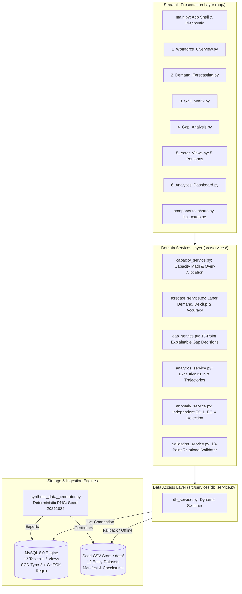
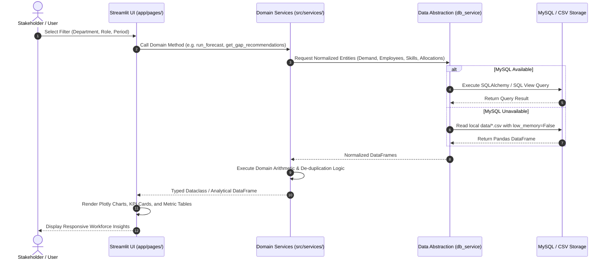

# Technical Documentation — Workforce Intelligence Platform

## 1. System Architecture

The Workforce Intelligence Platform implements a layered, domain-driven architecture designed for high availability, deterministic execution, and seamless persistence switching.



---

## 2. Technology Stack

| Layer | Component | Version / Specification | Rationale & Responsibility |
|---|---|---|---|
| **Language** | Python | `3.11.x` | Modern type hinting, dataclasses, pattern matching, high performance. |
| **Frontend** | Streamlit | `>=1.32.0` | Multi-page reactive dashboard with custom CSS, interactive filters, and expanders. |
| **Visualizations** | Plotly Express / Graph Objects | `>=5.20.0` | High-fidelity interactive charts, heatmaps, gauges, and trajectory plots. |
| **Data Processing** | Pandas & NumPy | `pandas>=2.2.0`, `numpy>=1.26.0` | Vectorized capacity arithmetic, time-series aggregation, and matrix transformations. |
| **Database & ORM** | MySQL 8.0 / PyMySQL / SQLAlchemy | `SQLAlchemy>=2.0.28`, `PyMySQL>=1.1.0` | 3NF relational schema, SCD Type 2 history, regex constraints, connection pooling. |
| **Configuration** | Pydantic & Pydantic-Settings | `pydantic>=2.6.4`, `pydantic-settings>=2.2.1` | Type-safe environment variable parsing with `.env` file support. |
| **Synthetic Generation** | Faker | `Faker>=24.0.0` | Deterministic synthetic demographic and operational event generation. |
| **Testing** | Pytest & Plugins | `pytest>=8.1.1`, `pytest-cov>=4.1.0` | Automated unit, integration, benchmark, and regression test suites. |

---

## 3. Data Flow & Execution Sequence



---

## 4. Module Architecture & Source Breakdown

### `src/config.py`
Manages application configuration using Pydantic `BaseSettings`. Handles environment variables (`DB_HOST`, `DB_PORT`, `DB_NAME`, `DB_USER`, `DB_PASSWORD`, `APP_ENV`), pool sizes, and automatically constructs safe, URL-encoded SQLAlchemy database URIs.

### `src/db/connection.py`
Provides thread-safe SQLAlchemy engine instantiation, connection pooling (`QueuePool`), health check diagnostics (`test_connection()`), and table verification helpers (`check_database_tables()`).

### `src/models/entities.py`
Defines 12 declarative SQLAlchemy 2.0 ORM models:
`Role`, `Employee`, `Skill`, `EmployeeSkill`, `Project`, `DemandPlan`, `Allocation`, `Availability`, `LeaveEvent`, `Training`, `GapAnalysis`, and `HistoricalEvent`. Enforces column nullability, types, foreign keys, and relationships.

### `src/services/db_service.py`
Acts as an abstraction boundary between UI and data sources. Inspects live database connectivity; if healthy, queries SQL views and tables; if offline or misconfigured, seamlessly streams data from `data/*.csv`.

### `src/services/capacity_service.py`
Executes source-driven capacity and availability calculations:
- `reconcile_weekly_capacities_df()`: Aggregates weekly employee capacity, deducting approved leave and project allocations without clamping negative balances.
- `calculate_over_allocation_pct()`: Quantifies exact over-allocation magnitude.
- `reconcile_employee_period_capacity()`: Granular period-level reconciliation for individual workers.

### `src/services/forecast_service.py`
Executes labor demand and supply forecasting:
- `run_forecast()` / `_compute_forecasts()`: Aggregates required FTE vs. qualified available FTE across ISO weeks (`YYYY'W'WW`) and months. Filters out stale skills (>18 months) and expired ratings.
- `detect_demand_duplicates()`: Identifies composite duplicates on `(project_id, role_id, skill_id, start_date, end_date)` and writes `data/demand_duplicate_exceptions.csv`.
- `forecast_comparison()`: Generates side-by-side raw vs. deduplicated forecast totals.
- `evaluate_forecast_accuracy()`: Performs holdout evaluation against committed project allocations, outputting MAE, RMSE, WAPE%, and Forecast Bias% to `data/forecast_accuracy_metrics.json`.

### `src/services/gap_service.py`
Identifies capability deficits and produces 13-point explainable action recommendations:
- Evaluates demand FTE, qualified internal supply, bench supply, proficiency deficits, and project deadlines.
- Classifies recommendations into `HIRE_EXTERNAL`, `REASSIGN_BENCH`, `UPSKILL_INTERNAL`, `ENGAGE_CONTRACTOR`, or `CROSS_TRAIN`.
- Populates all 13 explainability attributes with default review status `PROPOSED`.

### `src/services/anomaly_service.py`
Performs independent scanning for 4 operational edge cases directly from data:
- **EC-1**: Concurrent active allocation > 100% contracted capacity.
- **EC-2**: Active skill rating with evaluation date > 18 months old.
- **EC-3**: Demand double-counting (composite duplicate keys).
- **EC-4**: All-pairs overlapping project assignments for the same employee.
- Computes Precision, Recall, and F1 score against benchmark ground truth without feature leakage.

### `src/services/validation_service.py`
Executes comprehensive 13-point relational and semantic data integrity audits, generating `validation_summary.json`, `validation_errors.csv`, and `validation_report.json`.

### `src/generators/synthetic_data_generator.py`
Deterministic synthetic workforce generation engine parameterized by `--scale starter` (50 employees) or `--scale full` (5,000 employees). Uses seed `20261022`, injects 4 labeled edge cases, logs ground truth, and writes cryptographic SHA-256 manifests.

### `src/utils/id_generator.py`
Generates strictly deterministic, regex-validated primary keys (`EMP-XXXXXX`, `SKL-XXXXXX`, `PRJ-YYYY-XXXXXX`, `DEM-PRJ-...`, `ALLOC-...`, `LEV-...`, `EVT-...`).

---

## 5. Database Architecture & Schema Design

The relational database schema is implemented in `database/schema.sql` (MySQL 8.0+ / InnoDB / utf8mb4):

```
┌─────────────────────────────────────────────────────────────────────────────┐
│                            Relational Schema Map                            │
├─────────────────────┬──────────────────┬────────────────────────────────────┤
│ Table Name          │ Primary Key      │ Key Foreign Relationships          │
├─────────────────────┼──────────────────┼────────────────────────────────────┤
│ role                │ role_id          │ self-referencing (parent_role_id)  │
│ employee            │ employee_id      │ role_id, manager_id                │
│ skill               │ skill_id         │ (categorized taxonomy)             │
│ employee_skill      │ employee_skill_id│ employee_id, skill_id, verified_by │
│ project             │ project_id       │ project_manager_id (employee_id)   │
│ demand_plan         │ demand_id        │ project_id, role_id, skill_id      │
│ allocation          │ allocation_id    │ employee_id, project_id, demand_id │
│ availability        │ availability_id  │ employee_id                        │
│ leave_event         │ leave_id         │ employee_id, approver_id           │
│ training            │ training_id      │ employee_id, target_skill_id       │
│ gap_analysis        │ gap_analysis_id  │ demand_id, skill_id, role_id       │
│ historical_event_log│ event_id         │ (immutable audit trail)            │
└─────────────────────┴──────────────────┴────────────────────────────────────┘
```

### Analytical Views
1. `vw_active_workforce`: Active employees joined with roles, contracted hours, and manager info.
2. `vw_employee_skill_inventory`: Valid, verified employee competencies with freshness flags.
3. `vw_project_allocation_summary`: Project labor commitments, allocated FTE, and duration.
4. `vw_workforce_capacity_analysis`: Real-time cross-table synthesis of contracted hours, leave deductions, allocated hours, and bench availability.
5. `vw_actionable_gaps`: Open capability gaps prioritized by severity and action status.

---

## 6. Demand Forecasting & Accuracy Methodology

### Forecasting Logic
The forecasting engine evaluates labor requirements across discreet time slices (ISO weeks `YYYY'W'WW` or calendar months `YYYY-MM`):
1. **Demand Aggregation**: Sums required FTE per `(role_id, skill_id, period)`.
2. **Qualified Supply Identification**:
   - Filter active employees (`status = 'ACTIVE'`).
   - Match employees possessing the demanded `skill_id`.
   - Verify proficiency level $\ge$ demanded minimum proficiency.
   - Enforce freshness: `(Scenario Date - last_evaluated_date) <= 548 days` (18 months). Expired or stale skills are excluded from qualified supply.
3. **Capacity Allocation Deduction**:
   - Computes committed project allocations overlapping the demand period.
   - Deducts approved leave hours occurring within the period.
   - Derives true remaining supply FTE: $\text{Qualified Supply} - \text{Committed FTE}$.
4. **Deficit & Risk Classification**:
   - $\text{Gap FTE} = \max(0.0, \text{Demand FTE} - \text{Remaining Supply FTE})$.
   - $\text{Utilization \%} = \frac{\text{Demand FTE}}{\text{Qualified Supply FTE}} \times 100$.
   - **Risk Level**:
     - `CRITICAL`: Utilization $> 90\%$ or zero available qualified supply.
     - `HIGH`: Utilization between $80\%$ and $90\%$.
     - `MEDIUM`: Utilization between $60\%$ and $80\%$.
     - `LOW`: Utilization $\le 60\%$.

### Holdout Accuracy Evaluation
The platform evaluates forecasting precision through holdout backtesting (`evaluate_forecast_accuracy()`):
- **Mean Absolute Error (MAE)**:
  $$\text{MAE} = \frac{1}{n} \sum_{i=1}^{n} |F_i - A_i|$$
- **Root Mean Squared Error (RMSE)**:
  $$\text{RMSE} = \sqrt{\frac{1}{n} \sum_{i=1}^{n} (F_i - A_i)^2}$$
- **Weighted Absolute Percentage Error (WAPE %)**:
  $$\text{WAPE} = \frac{\sum |F_i - A_i|}{\sum A_i} \times 100$$
- **Forecast Bias %**:
  $$\text{Bias} = \frac{\sum (F_i - A_i)}{\sum A_i} \times 100$$

---

## 7. Automated Testing Strategy

The test suite consists of **57 automated Pytest tests** organized across 7 modules:

1. `tests/test_capacity_service.py` (10 tests):
   - Full-time unallocated capacity (40h = 1.0 FTE).
   - Part-time scaling (0.5 FTE = 20h).
   - Approved leave deduction (PTO reduces capacity).
   - Full-week leave yielding `ON_APPROVED_LEAVE`.
   - Combined FTE, leave, and allocation interactions.
   - Full allocation boundary (remaining capacity = 0).
   - Over-allocation detection and percentage calculation (>100%).
   - Zero-capacity boundary conditions.
   - Leave exceeding contracted capacity boundary handling.
   - Multi-project weekly reconciliation.

2. `tests/test_id_generator.py` (16 tests):
   - Regex pattern compliance across all 12 entities (`EMP-`, `SKL-`, `PRJ-`, `DEM-`, `ALLOC-`, `AVL-`, `TRN-`, `GAP-`, `LEV-`, `EVT-`, `ROL-`).
   - Monotonic sequential incrementing and format stability.

3. `tests/test_db_connection.py` (7 tests):
   - Database URL construction with URL-encoded special characters.
   - Default configuration fallback.
   - Core tables completeness list.
   - Graceful fallback when database is unreachable.
   - Mocked connection pool handling.
   - Live database probing.

4. `tests/test_data_generator.py` (4 tests):
   - Starter data files existence and headers.
   - Ground truth anomaly injection presence.
   - Foreign key relational integrity.
   - Capacity arithmetic reconciliation.

5. `tests/test_master_verification.py` (8 tests):
   - Leave event integrity and contracted capacity deductions.
   - Historical event log JSON validation and audit trail consistency.
   - Anomaly detection 100% Precision/Recall/F1 benchmark on injected ground truth.
   - 300+ unique skills taxonomy across 8 professional domains.
   - Two-run deterministic reproducibility verification via SHA-256 checksum comparison.
   - Full 2026 ISO week coverage (all 53 ISO weeks from `2026-W01` to `2026-W53`) and project date containment.
   - Anomaly detection edge cases (eliminating false positives on sequential allocations, detecting multiple simultaneous project overlap pairs, and robust empty/null date handling).
   - Period-specific forecasting with active allocations, approved leave deductions, and multi-demand capacity tracking.

6. `tests/test_requirements_gap_closure.py` (7 tests):
   - Data validation service execution (13-point audit producing summary and report).
   - Weekly capacity reconciliation engine (unclamped over-allocations).
   - Demand duplicate exception detection and corrected forecast comparison.
   - Recommendation explainability (13 attributes verified on all recommendations).
   - Ground truth isolation (confirming anomaly detection never reads GT files).
   - Forecast accuracy holdout evaluation (MAE, RMSE, WAPE%, Bias%).
   - Lifecycle audit events coverage (all 7 operational types).

7. `tests/test_services.py` (5 tests):
   - Forecast risk levels categorization.
   - Gap severity business rules.
   - Gap recommendation decision tree logic.
   - DB service fallback to local seed data.
   - Analytics service executive KPI computations.
